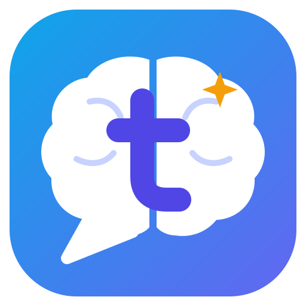
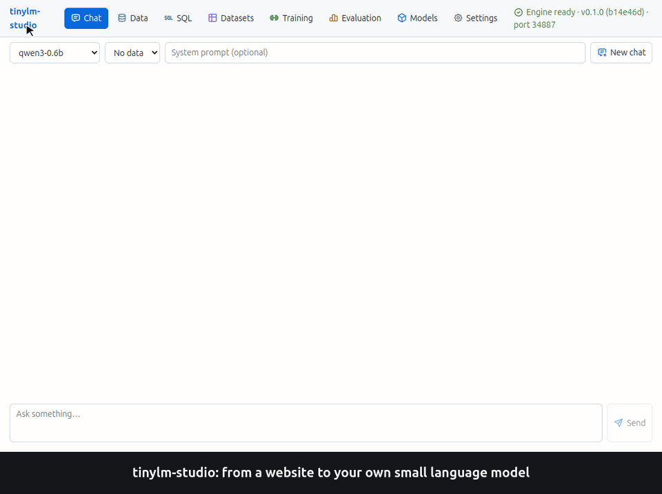
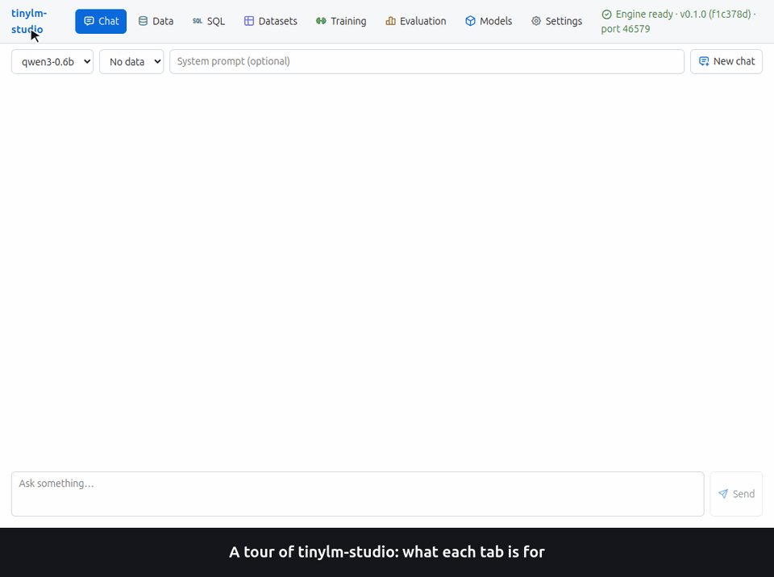
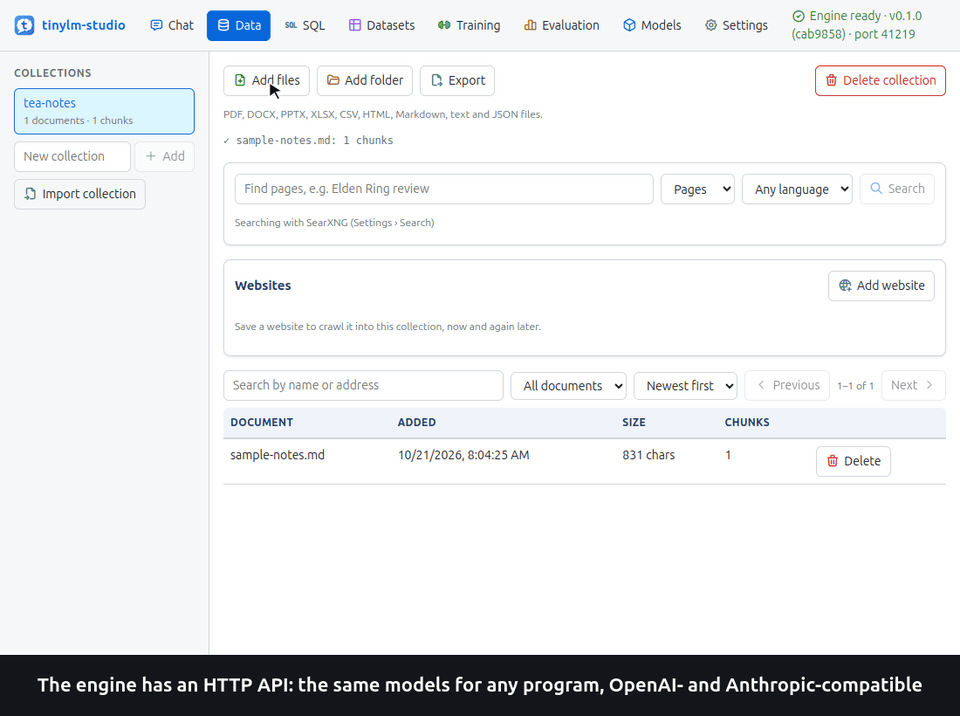

#  tinylm-studio



From a website to a trained model in one walkthrough ([in Ukrainian](docs/images/walkthrough-uk.gif);
see [docs/demo.md](docs/demo.md)).



A tour of every tab: what can be added where and what each option is for
([in Ukrainian](docs/images/tour-uk.gif)).



The engine's OpenAI- and Anthropic-compatible API, tried in Swagger UI
([in Ukrainian](docs/images/api-uk.gif)).

A desktop studio for building small, narrowly specialized language models that run without a powerful GPU.


Chat with local models, let them answer from your files and websites (with sources), collect
pages and trailers from the web, generate training examples from your documents with a larger
teacher model (local, OpenRouter including its free models, any OpenAI-compatible API,
Anthropic, or a Claude, ChatGPT or Google subscription through its command-line tool), fine-tune a small model on them, and compare it with the base model on held-out
questions, scored by a judge model. A fine-tuned model is exported to GGUF to run as fast as
any llama.cpp model. The
**[user guide](docs/user-guide.md)** walks through every screen and setting.

- **engine/** – Python service: data ingestion, retrieval, training and inference, exposed through OpenAI- and Anthropic-compatible APIs.
- **desktop/** – Electron app that starts the engine and drives it over HTTP, or connects to an
  engine running elsewhere: a server, a cluster, or a RunPod GPU or CPU pod it starts and stops itself
  ([deployment.md](docs/deployment.md)).
- **docs/** – the [user guide](docs/user-guide.md), the [API reference](docs/api.md), the
  [implementation plan](docs/implementation-plan.md) and how the
  [walkthrough, tour and API GIFs](docs/demo.md) are made.

## Requirements

- Linux (Debian-based; Alpine support is planned, see the plan)
- Python 3.11+ and [uv](https://docs.astral.sh/uv/) (falls back to `python3 -m venv` if uv is missing)
- Node.js 20+

## Quick start

```bash
make setup   # create the engine environment and install desktop dependencies
make run     # start the desktop app (it starts the engine)
make desktop-entry   # optional, Linux: add the app with its icon to the system menu
```

Or install a package: download the `.deb` or `.rpm` of a release from
[GitHub releases](https://github.com/redacid/tinylm-studio/releases), or build one and install it
like any other app ([Installing the app](docs/user-guide.md#installing-the-app)):

```bash
make deb       # or: make rpm, make appimage, make tarball, make package (all of them)
sudo apt install ./desktop/out/tinylm-studio-0.1.0-5a0d901-amd64.deb   # named by the tag at a release tag
```

Download a model (Models tab in the app, which also searches all GGUF and PyTorch models on
Hugging Face, or):

```bash
make download MODEL=gemma-3-4b-gguf
```

For gated models and faster downloads, put a Hugging Face token into `.env`
(`cp .env.example .env`); every `make` target passes it on. Also accept each gated model's
license on Hugging Face with the same account; if a download is refused, see
[Troubleshooting](docs/user-guide.md#a-gated-model-does-not-download).

Add your own data (Data tab in the app, or a whole folder from the command line), then pick the
collection in the chat to get answers that cite it:

```bash
make ingest COLLECTION=games FILES=~/Documents/games
make crawl COLLECTION=games URLS="https://example.com/reviews/"  # run again for the next new pages
```

The **SQL** tab queries the data directly (SQLite: documents, chunks, full-text search,
crawled pages) and deletes what a `DELETE` matches after asking, with the tables' fields and
example queries; see
[SQL](docs/user-guide.md#sql).

Crawling can go through a proxy (`TINYLM_PROXY=socks5://127.0.0.1:1080` in `.env`) and, for
sites that need JavaScript, through a real Chrome/Chromium controlled over CDP; see
[Proxy](docs/user-guide.md#proxy) and [Browser (CDP)](docs/user-guide.md#browser-cdp).

To find sites and trailers instead of typing addresses, start a local SearXNG once (Docker or
Podman) and search from the Data tab or the command line:

```bash
make searxng
make search Q="elden ring review" ADD=games
make search Q="elden ring trailer" VIDEO=1 ADD=games
```

Brave Search, Tavily, Exa, Perplexity and Serper work too, with their API keys, and searches can
be limited to or keep away from chosen sites; see
[Search settings](docs/user-guide.md#search-settings). Whether the crawler follows robots.txt,
its request rate and the defaults for new websites are in
[Crawler settings](docs/user-guide.md#crawler-settings).

To teach a model your answer style, fine-tune it with LoRA: download a model with PyTorch
weights (`make download MODEL=qwen3-0.6b`), import examples on the Datasets tab (JSONL or CSV;
[docs/examples/game-hints.jsonl](docs/examples/game-hints.jsonl) is a small sample), start a run
on the Training tab and pick the new model in the chat. **Export to GGUF** on the Models tab
then makes it as fast as the other llama.cpp models. See
[the user guide](docs/user-guide.md#training) and [docs/api.md](docs/api.md#fine-tuning).

The chat's answer length, temperature, repetition penalty, number of sources and default system
prompt are on the Settings tab and are kept after a restart, together with the conversation; see
[Chat settings](docs/user-guide.md#chat-settings).

The engine is meant to run in a container in a Kubernetes cluster; see
[docs/deployment.md](docs/deployment.md) for what that requires and what is still missing.
`docker compose up -d` runs the engine image with SearXNG and a headless Chrome
([docker-compose.yaml](docker-compose.yaml), [Docker Compose](docs/deployment.md#docker-compose)).

Engine only, for API clients (see [docs/api.md](docs/api.md)):

```bash
make setup-engine
make run-engine PORT=8765
make health
```

The engine serves OpenAI-compatible (`/v1/chat/completions`) and Anthropic-compatible
(`/v1/messages`) APIs. Its OpenAPI schema is at `/openapi.json` (Swagger UI at `/docs`), and
`make openapi` prints it without a running engine, for importing into Postman, Insomnia or a
client generator ([docs/api.md](docs/api.md#openapi-schema)).

Run `make help` for all targets.

## Python environment

By default the engine lives in its own virtual environment at
`${XDG_DATA_HOME:-~/.local/share}/tinylm-studio/venv`, created automatically.

To use your own environment instead, set `TINYLM_PYTHON` to its interpreter:

```bash
export TINYLM_PYTHON=/path/to/your/venv/bin/python
scripts/setup-engine.sh   # installs the engine into that environment
```

`TINYLM_VENV` changes where the managed environment is created.

`TINYLM_LLAMA` picks the llama.cpp build: `cpu` (default, prebuilt wheel) or `source`
(compile; e.g. `CMAKE_ARGS="-DGGML_CUDA=on"` for NVIDIA GPUs).

`TINYLM_TORCH` picks the PyTorch build: `cpu` (default, small), `auto` (detect GPU),
a CUDA version such as `cu128`, or `pypi`.

More commands (`make models`, `make bench`, `make searxng-stop`, `make chrome` for a headless
browser in Docker, `make info`, ...) are listed in
the [user guide](docs/user-guide.md#command-line) and by `make help`.

## Development

```bash
make setup-dev   # once: install pytest and ruff into the engine environment
make check       # lint + type check + tests; run before committing
make test        # engine tests only
make lint        # ruff for the engine, TypeScript type check for the desktop app
make format      # auto-format and fix engine code
make build       # compile the desktop app into desktop/dist
make image       # engine container image tagged <tag>-<variant> or <version>-<commit>-<variant> (VARIANT=cuda)
make base        # its base image (llama.cpp, PyTorch); make image builds it when missing
make clean       # remove build outputs and caches
make distclean   # also remove node_modules and the managed engine environment
make release VERSION=0.2.0   # set the version, write release notes, commit and tag
```

Releases are git tags like `0.2.0`, made by `make release`; pushing the tag to GitHub runs the
tests and publishes the `.deb` and `.rpm` packages as a GitHub release. Packages and images built
at a release tag are named by the tag, anywhere else by the commit. GitHub Actions also run the
checks on every push and pull request, and build engine images for each release tag. See
[docs/releasing.md](docs/releasing.md) and [CHANGELOG.md](CHANGELOG.md).

Training tests build a tiny random model on the spot, so they need no download.

Documentation screenshots in `docs/images/` are taken from the running app with the test model
and sample data; retake them when a screen changes. `make demo-gif` records the walkthrough GIFs
(`docs/images/walkthrough-en.gif`, `walkthrough-uk.gif`) from a scenario, from crawling a website
to chatting with the model trained on it, and `make demo-tour` the tour of every tab
(`tour-en.gif`, `tour-uk.gif`), and `make demo-api` the public API in Swagger UI (`api-en.gif`,
`api-uk.gif`); see [docs/demo.md](docs/demo.md).

## License

tinylm-studio is licensed under the [Apache License 2.0](LICENSE); see also [NOTICE](NOTICE).
Its dependencies use permissive licenses (MIT, BSD, ISC, Apache-2.0).

Models are not part of the project: the app downloads them from Hugging Face, and each one comes
with its own license, which also covers the models you fine-tune from it. Qwen3 and SmolLM2 are
Apache-2.0 and multilingual-e5-small is MIT, while Llama 3.2 (Llama 3.2 Community License) and
Gemma (Gemma Terms of Use) restrict how they may be used and shared. Check the model card before
publishing or selling a fine-tuned model. The CUDA engine image is built on NVIDIA's CUDA images,
which are covered by the NVIDIA CUDA EULA.
